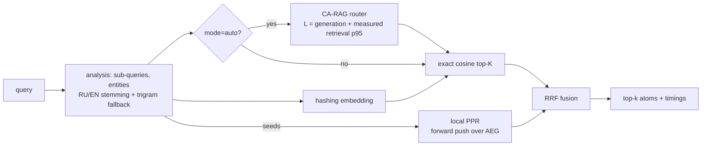

# Fast-AtomRAG Core

[](https://github.com/Sega757/Fast-AtomRAG-Core/actions/workflows/ci.yml)


Low-latency **vector + graph retrieval** service for AtomRAG: knowledge atoms linked through an Atom-Entity Graph (AEG), local Personalized PageRank, rank fusion (RRF), and an optional **cost-aware router** (CA-RAG) that respects a latency SLA.

The service does **not** generate answers. It returns context (atoms) plus a routing decision; plug in any LLM generator downstream.

## Highlights

- **Multi-hop retrieval in milliseconds** — 2–3 hop chains found through shared entities, even when the target atom shares no words with the question.
- **Morphology-aware entity matching** — pure-stdlib Snowball (Russian) and Porter (English) stemmers plus a char-trigram fallback for typos. "коллапса маршрутизатора" and "коллапс маршрутизатора" resolve to one graph node.
- **Local PPR** — forward-push Personalized PageRank touches only the seed neighbourhood; graph phase stays ~5.5 ms from 10k to 100k atoms.
- **Self-calibrating router** — rolling p95 latency per retrieval mode feeds the SLA filter.
- **Crash-safe writes** — SQLite (WAL) is the source of truth; memory is mutated only after commit.
- **Minimal stack** — FastAPI, uvicorn, pydantic, prometheus-client, numpy. No vector DB, no NLP libraries.

## How it works



| Layer | Contents |
|---|---|
| `domain/` | Atom, AEG graph, PPR, fusion, router, stemmers, query analysis. Stdlib only. |
| `application/` | Use cases (upsert / delete / search), ports, latency tracker |
| `infrastructure/` | SQLite repository, numpy index, hashing embedder, config |
| `api/` | FastAPI app, Prometheus metrics |

Design decisions and trade-offs are recorded in [`docs/ADR.md`](docs/ADR.md).

## Quick start

**Docker**
```bash
docker compose up -d --build
curl localhost:8000/health/ready
```

**Local (Python 3.12)**
```bash
python -m venv .venv && source .venv/bin/activate   # Windows: .venv\Scripts\activate
pip install -r requirements.lock && pip install -e ".[dev]"
uvicorn fast_atomrag.api.app:create_app --factory --port 8000
```

Swagger UI: http://localhost:8000/docs · Metrics: http://localhost:8000/metrics

## API

```bash
# Create or replace an atom (idempotent): 201 = created, 200 = updated
curl -X PUT localhost:8000/api/v1/atoms/1 -H 'Content-Type: application/json' \
  -d '{"text": "Company Alpha acquired startup Beta.", "entities": ["Alpha", "Beta"]}'
curl -X PUT localhost:8000/api/v1/atoms/2 -H 'Content-Type: application/json' \
  -d '{"text": "Beta developed the Gamma protocol.", "entities": ["Beta", "Gamma"]}'

# Search: mode = graph (default) | vector | auto (router)
curl -X POST localhost:8000/api/v1/search -H 'Content-Type: application/json' \
  -d '{"query": "What did the company acquired by Alpha develop?", "top_k": 3}'

curl localhost:8000/api/v1/atoms/1            # get
curl -X DELETE localhost:8000/api/v1/atoms/1  # delete (204 / 404)
```

| Endpoint | Purpose |
|---|---|
| `PUT /api/v1/atoms/{id}` | Upsert an atom (requires `X-API-Key` if configured) |
| `GET /api/v1/atoms/{id}` | Fetch an atom |
| `DELETE /api/v1/atoms/{id}` | Delete an atom (requires `X-API-Key` if configured) |
| `POST /api/v1/search` | Retrieve atoms; response includes seeds, scores, route and per-phase timings |
| `GET /api/v1/stats` | Atom / entity counts, embedder id |
| `GET /health/live`, `GET /health/ready` | Liveness / readiness; readiness also reports router calibration |
| `GET /metrics` | Prometheus metrics |

Storage failures return `503 storage unavailable` and leave in-memory state untouched. `/health/ready` exposes router calibration: `p50_ms`, `p95_ms`, `sample_count` per mode and the `sla_fallbacks` counter.

## Configuration

| Variable | Default | Description |
|---|---|---|
| `ATOMRAG_DB_PATH` | `./data/atoms.db` | SQLite file (`/data/atoms.db` in Docker, mounted as a volume) |
| `ATOMRAG_API_KEY` | — | Write API key, at least 16 characters |
| `ATOMRAG_EMBED_DIM` | `512` | Embedding dimension (changing it triggers re-embedding on startup) |
| `ATOMRAG_ALPHA` | `0.65` | Weight of the semantic signal vs. the graph signal |
| `ATOMRAG_FUSION` | `rrf` | `rrf` or `linear` |
| `ATOMRAG_ENTITY_STEMMING` | `true` | Stem entity keys (Snowball-RU / Porter-EN) |
| `ATOMRAG_FUZZY_THRESHOLD` | `0.75` | Trigram-Jaccard threshold for fallback matching; `0` disables it |
| `ATOMRAG_CANDIDATE_K` | `50` | Candidates taken from each channel |
| `ATOMRAG_PPR_RESTART` / `_EPS` / `_MAX_PUSHES` | `0.15` / `1e-4` / `20000` | PPR parameters |
| `ATOMRAG_SLA_SECONDS` | `2.0` | End-to-end SLA used by the router |
| `ATOMRAG_LOG_LEVEL` | `INFO` | Log level |

Invalid values stop the service at startup (fail-fast).

## Performance

Measured in-process on 1 vCPU, dim 512: `python bench/bench_retrieval.py --atoms 100000`

| Atoms | Vector p95 | Graph p95 (full retrieval) | PPR p95 | Entity matching p95 | Load from SQLite |
|---|---|---|---|---|---|
| 10,000 | 2.2 ms | 8.9 ms | 5.5 ms | 0.11 ms | 0.6 s |
| 100,000 | 24.6 ms | 29.6 ms | 5.6 ms | 0.12 ms | 6.8 s |

LLM generation is not included. Indexing throughput: ~1.8k atoms/s.

## Multi-hop quality (stress corpus)

`python bench/eval_recall.py` — 66 atoms, 15 chains of 2–3 hops (RU/EN), 30 lexical distractors, shared entities written in different inflected forms:

| Variant | Recall@5 | 2-hop | 3-hop | MRR@10 |
|---|---|---|---|---|
| vector only | 0.000 | 0.000 | 0.000 | 0.016 |
| linear fusion | 0.533 | 0.889 | 0.000 | 0.156 |
| RRF, no stemming | 0.000 | 0.000 | 0.000 | 0.016 |
| **RRF + stemming** | **1.000** | **1.000** | **1.000** | **0.322** |

The corpus is small and hand-written: it validates the mechanism, not real-world retrieval quality.

## Limitations

- The embedder is lexical (feature hashing): it does not capture synonyms or paraphrases.
- Stemming is not lemmatization: rare over-stemming and missed irregular forms are possible.
- The router calibrates only its own share of latency (retrieval). LLM generation time and quality priors remain assumptions until the generator reports feedback.
- One process owns the index; horizontal scaling is described in the Evolution Path section of the ADR.

## Development

```bash
ruff check . && ruff format --check . && pytest -q
```

CI (`.github/workflows/ci.yml`): lint → tests → recall report → 10k benchmark → image build → `/health/ready` smoke test → push to GHCR (`main` only).
