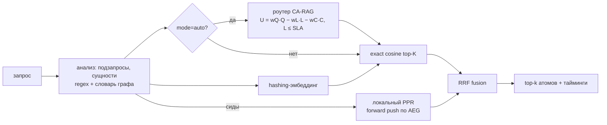

# Fast-AtomRAG Core

Сервис быстрого **векторно-графового retrieval** для AtomRAG: атомы знаний + граф сущностей (AEG), локальный Personalized PageRank, слияние сигналов (RRF) и опциональный **cost-aware роутер** (CA-RAG) под SLA.

LLM-генерации здесь нет: сервис отдаёт контекст (атомы) и решение роутера, генератор подключается снаружи.

## Как это работает



| Слой | Что внутри |
|---|---|
| `domain/` | Атом, граф AEG, PPR, fusion, роутер, анализ запроса. Только stdlib. |
| `application/` | Use cases (upsert / delete / search), порты |
| `infrastructure/` | SQLite-хранилище, numpy-индекс, hashing-эмбеддер, конфиг |
| `api/` | FastAPI, Prometheus-метрики |

Почему так, а не как в исходном прототипе — в [`docs/ADR.md`](docs/ADR.md).

## Запуск

**Docker:**
```bash
docker compose up -d --build
curl localhost:8000/health/ready
```

**Локально (Python 3.12):**
```bash
python -m venv .venv && source .venv/bin/activate   # Windows: .venv\Scripts\activate
pip install -r requirements.lock && pip install -e ".[dev]"
uvicorn fast_atomrag.api.app:create_app --factory --port 8000
```

Swagger: http://localhost:8000/docs · метрики: http://localhost:8000/metrics

## API

```bash
# добавить / заменить атом (идемпотентно): 201 — создан, 200 — обновлён
curl -X PUT localhost:8000/api/v1/atoms/1 -H 'Content-Type: application/json' \
  -d '{"text": "Компания Альфа купила стартап Бета.", "entities": ["Альфа", "Бета"]}'
curl -X PUT localhost:8000/api/v1/atoms/2 -H 'Content-Type: application/json' \
  -d '{"text": "Бета разработала протокол Гамма.", "entities": ["Бета", "Гамма"]}'

# поиск: mode = graph (по умолчанию) | vector | auto (роутер)
curl -X POST localhost:8000/api/v1/search -H 'Content-Type: application/json' \
  -d '{"query": "Что разработала компания, которую купила Альфа?", "top_k": 3}'

curl localhost:8000/api/v1/atoms/1          # получить
curl -X DELETE localhost:8000/api/v1/atoms/1 # удалить (204 / 404)
```

Если задан `ATOMRAG_API_KEY`, запросы `PUT`/`DELETE` требуют заголовок `X-API-Key`. Сбой хранилища — `503 storage unavailable`, память при этом не меняется.

`/health/ready` показывает калибровку роутера: `p50_ms`, `p95_ms`, `sample_count` по режимам и счётчик `sla_fallbacks`.

## Конфигурация (env)

| Переменная | По умолчанию | Смысл |
|---|---|---|
| `ATOMRAG_DB_PATH` | `./data/atoms.db` | файл SQLite (в Docker `/data/atoms.db`, volume) |
| `ATOMRAG_API_KEY` | — | ключ для записи, ≥ 16 символов |
| `ATOMRAG_EMBED_DIM` | `512` | размерность эмбеддинга (смена → переэмбеддинг при старте) |
| `ATOMRAG_ALPHA` | `0.65` | вес семантики против графа |
| `ATOMRAG_FUSION` | `rrf` | `rrf` или `linear` |
| `ATOMRAG_ENTITY_STEMMING` | `true` | стемминг ключей сущностей (Snowball-RU / Porter-EN) |
| `ATOMRAG_FUZZY_THRESHOLD` | `0.75` | порог trigram-Jaccard для fallback-матчинга, `0` — выключить |
| `ATOMRAG_CANDIDATE_K` | `50` | кандидатов из каждого канала |
| `ATOMRAG_PPR_RESTART` / `_EPS` / `_MAX_PUSHES` | `0.15` / `1e-4` / `20000` | параметры PPR |
| `ATOMRAG_SLA_SECONDS` | `2.0` | SLA для роутера |
| `ATOMRAG_LOG_LEVEL` | `INFO` | уровень логов |

Неверное значение — сервис не стартует (fail-fast).

## Производительность (измерено, 1 vCPU, dim 512)

`python bench/bench_retrieval.py --atoms 100000`

| Атомов | vector p95 | graph p95 (вся retrieval-фаза) | из них PPR p95 | матчинг сущностей p95 | загрузка из SQLite |
|---|---|---|---|---|---|
| 10 000 | 2.2 мс | 8.9 мс | 5.5 мс | 0.11 мс | 0.6 с |
| 100 000 | 24.6 мс | 29.6 мс | 5.6 мс | 0.12 мс | 6.8 с |

Генерация LLM не входит. Индексация: ~1.8k атомов/с.

## Качество мультихопа (стресс-корпус)

`python bench/eval_recall.py` — 66 атомов, 15 цепочек на 2–3 хопа (RU/EN), 30 дистракторов, сущности в разных падежах:

| | Recall@5 | 2-hop | 3-hop | MRR@10 |
|---|---|---|---|---|
| vector_only | 0.000 | 0.000 | 0.000 | 0.016 |
| linear_fusion | 0.533 | 0.889 | 0.000 | 0.156 |
| rrf без стемминга | 0.000 | 0.000 | 0.000 | 0.016 |
| **rrf + стемминг** | **1.000** | **1.000** | **1.000** | **0.322** |

Корпус ручной и маленький: это проверка механизма, а не оценка на реальных данных.

## Ограничения
- Эмбеддер лексический (hashing): синонимы и перефразы не ловит.
- Стемминг — не лемматизация: редкие ошибочные склейки основ и пропуск нерегулярных форм возможны.
- Роутер калибрует только свою часть латентности (retrieval); время LLM-генерации и приоры качества — допущения до появления обратной связи от генератора.
- Один процесс на индекс; горизонтальное масштабирование — см. Evolution Path в ADR.

## Тесты
```bash
ruff check . && ruff format --check . && pytest -q
```
CI (`.github/workflows/ci.yml`): линт → тесты → отчёт recall → бенчмарк 10k → сборка образа → smoke `/health/ready` → push в GHCR (только из `main`).
